<p align="center">
  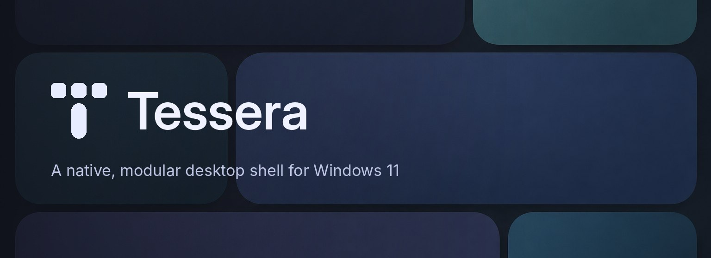
</p>

<p align="center">
  <a href="https://github.com/redstone-md/tessera/releases"></a>
  <a href="LICENSE"></a>
  
  
  
</p>

<p align="center">
  <b>Bars, dock, launcher, file manager, tiling, widgets and themes — drawn natively on the GPU.</b><br>
  No WebView, no Electron, no injected DLLs. One Rust process that replaces the everyday surfaces of Explorer.
</p>

---

> [!NOTE]
> Tessera is young and moves fast. Everything listed below exists in the code; [docs/FEATURES.md](docs/FEATURES.md) records, feature by feature, what was tried on a running shell and what was not.

## Contents

- [Why Tessera](#why-tessera)
- [Features](#features)
- [File manager](#file-manager)
- [Themes](#themes)
- [Plugins](#plugins)
- [Install](#install)
- [Configure](#configure)
- [Build from source](#build-from-source)
- [Documentation](#documentation)
- [Contributing](#contributing) · [License](#license)

## Why Tessera

|  |  |
| --- | --- |
| **Native and light** | Written in Rust on [GPUI](https://www.gpui.rs), the GPU-accelerated UI framework of Zed. Bars redraw only when what they show changes; lists draw only the rows in sight. |
| **Modular** | Every surface is a set of widgets placed by a TOML layout. Rearrange them by dragging, or write the layout by hand; changes apply live. |
| **Extensible, safely** | Plugins are WebAssembly components run in a [Wasmtime](https://wasmtime.dev) sandbox with explicit, per-host and per-file permissions. |
| **Honest** | A control that cannot do something says so. Nothing is faked; every limit is written down. |
| **Recoverable** | A watchdog brings the Windows taskbar back however Tessera exits. Nothing is injected into other processes. |

Tessera takes [Seelen UI](https://github.com/eythaann/Seelen-UI) as its functional reference and is implemented independently, with a Material 3 Expressive look.

## Features

| Area | What you get |
| --- | --- |
| **Top bar & dock** | Floating pills or flat bars at the top or bottom of every display, auto-hide, game-aware hiding, drag-and-drop widget arrangement, pinned apps with notification badges and jump lists, window previews. |
| **Launcher & Start** | Apps from the Start menu and the Store as tiles, files through the Windows Search index, settings pages; pinned apps and power actions. |
| **File manager** | A replacement for Explorer windows: details and tiles views, the Shell's own copy/move/delete, the shared clipboard of files, rename in place, properties, terminal here. [More below.](#file-manager) |
| **Window management** | Floating by default; optional tiling (`master`, `columns`, `rows`, `grid`, `monocle`) with gaps and animated moves; focus and swap by direction; own workspaces or Windows virtual desktops with an overview. |
| **Switcher** | Alt+Tab replacement with live window thumbnails. |
| **Quick settings** | Wi‑Fi (join, password), VPN, Bluetooth, volume per app and device, microphone, brightness over DDC/CI, HDR, power plan, light/dark mode. |
| **Status** | Clock and calendar, notification centre and banners, media controls with artwork, tray icons, CPU, memory, battery, disk and network meters, keyboard layout, Recycle Bin, updates. |
| **Desktop** | Wallpapers (pictures, slideshows, video), desktop cards of widgets, volume flyout. |
| **Customisation** | 21 themes, colour from the Windows accent, WCAG contrast guard, springs for every motion, icon replacements, six interface languages. |
| **Automation** | Global key bindings and a command line (`tessera popup`, `tiling`, `focus`, `move`, `dock`, `files`, `restart`, `quit`). |
| **Marketplace** | 16 plugins and 21 themes to install from registries, with pictures, checksums and a permission prompt. |

## File manager

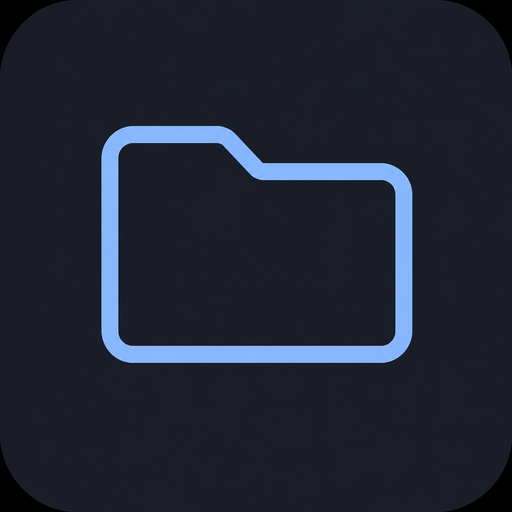

Tessera has its own file manager, built to take over from Explorer windows entirely.

- **Open it** with `Win+E` (bind `files = "~"` to any key), the `files` widget, `tessera files [folder]`, or any folder in the user menu and launcher.
- **Navigate** with back, forward and up, clickable path steps or a typed path (`Ctrl+L`), a live filter (`Ctrl+F`), places and drives at the side, and *This PC* with a usage bar per drive.
- **Work with files** as in Explorer: open, cut/copy/paste (interoperates with Explorer's clipboard both ways), Recycle Bin or permanent delete, rename in place (`F2`), new folder (`Ctrl+Shift+N`), properties (`Alt+Enter`), open in terminal, show hidden files (`Ctrl+H`), several windows (`Ctrl+N`).
- **Fast** on large folders: folders are read off the UI thread, only visible rows are drawn, icons are cached per file type and loaded a dozen per frame, and a folder is re-read only when Windows says it changed.
- **Safe**: copy, move and delete go through the Windows Shell, so its progress and conflict dialogs appear and every operation can be undone in Explorer.

Tabs, drag and drop, picture previews and deep search are next. See [docs/FEATURES.md](docs/FEATURES.md) for the full list and what is not done yet.

## Themes

Every theme sets colours, shapes, spacing, type and motion. Install them from **Settings → Themes**, or copy a file from [`themes/`](themes) to `%APPDATA%\tessera\themes\`. Each comes with a matching wallpaper in [`registry/wallpapers/`](registry/wallpapers).

<table>
<tr>
<td>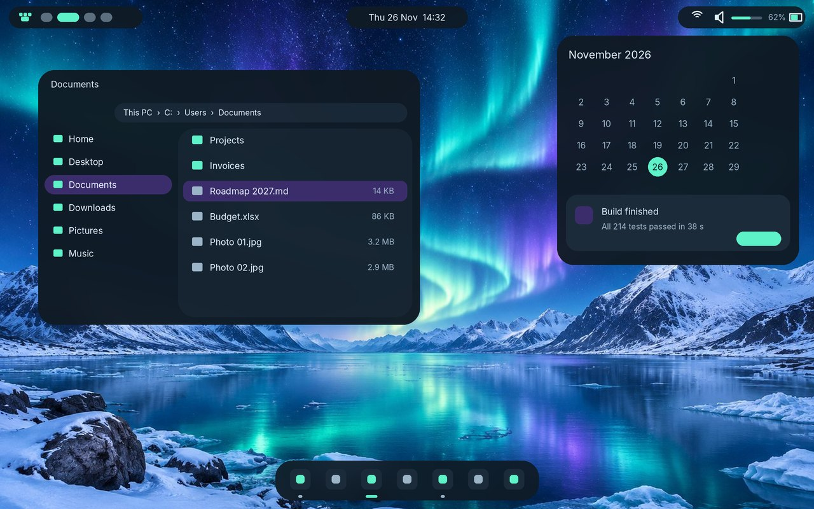<br><b>Aurora</b> · night teal and violet</td>
<td>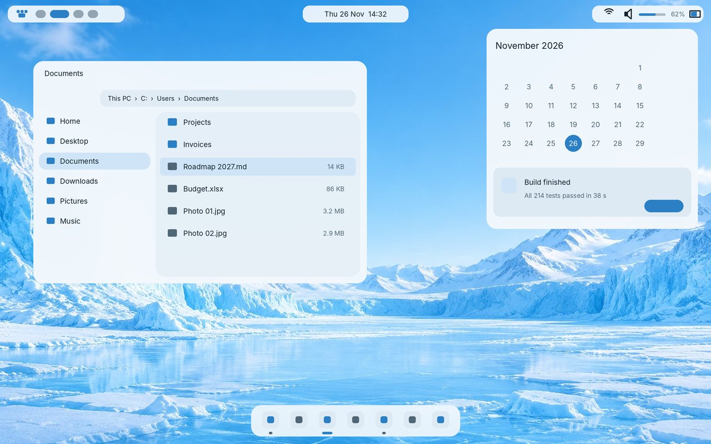<br><b>Glacier</b> · crisp ice blues, light</td>
<td>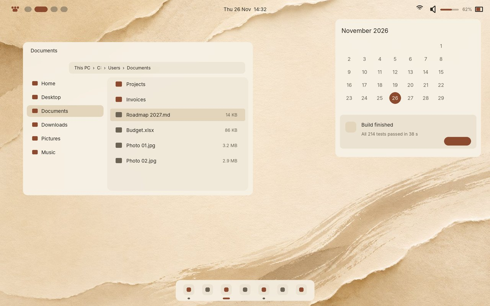<br><b>Paper</b> · ink on warm paper, flat</td>
</tr>
<tr>
<td>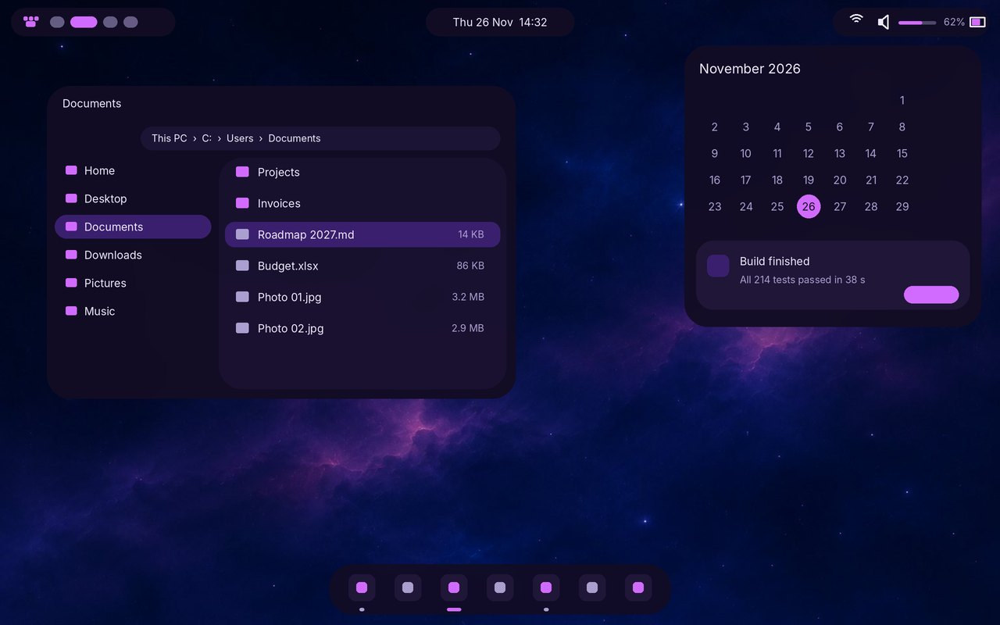<br><b>Nebula</b> · magenta and indigo</td>
<td>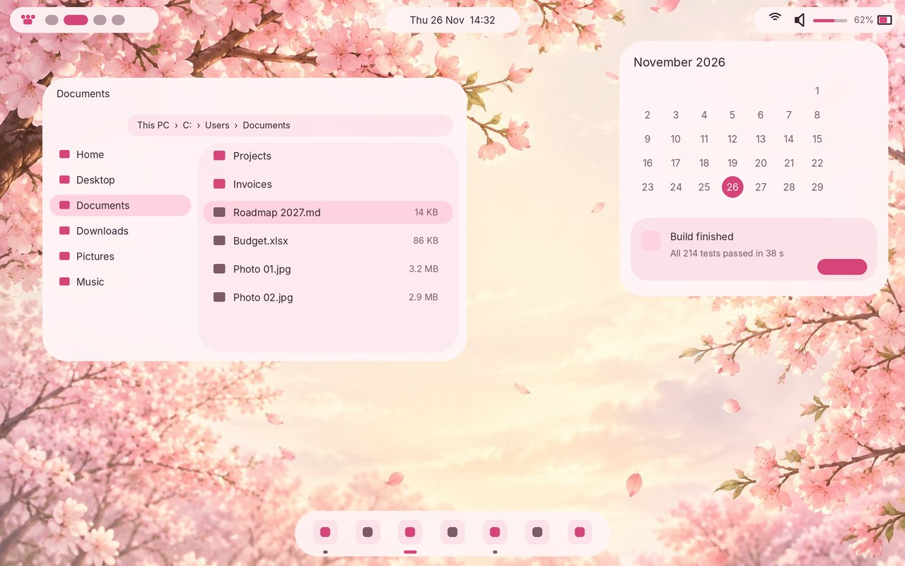<br><b>Sakura</b> · soft pinks, round</td>
<td>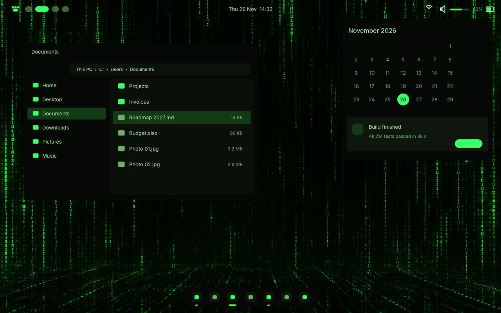<br><b>Terminal</b> · phosphor green, mono</td>
</tr>
<tr>
<td>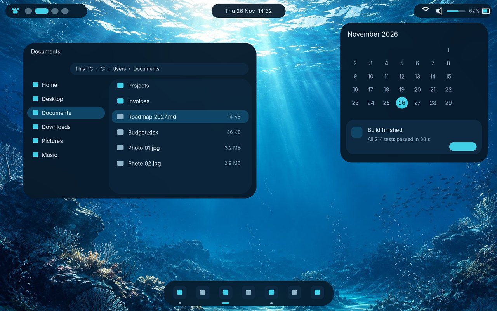<br><b>Ocean</b> · navy and aqua</td>
<td>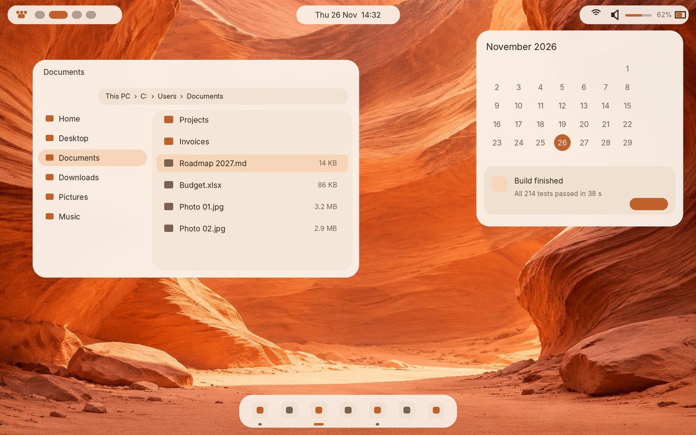<br><b>Sandstone</b> · terracotta, light</td>
<td>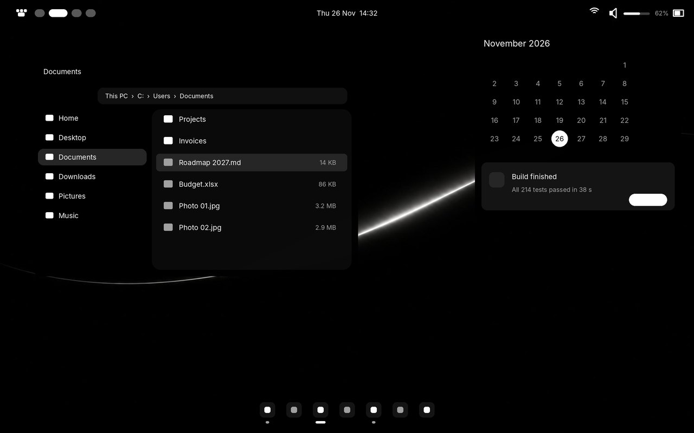<br><b>OLED</b> · true black, still</td>
</tr>
</table>

<details>
<summary><b>All 21 themes</b></summary>

| Theme | Scheme | Character |
| --- | --- | --- |
| [Arcade](registry/previews/arcade.jpg) | dark | square pixels, red neon and teal |
| [Aurora](registry/previews/aurora.jpg) | dark | night teal and violet |
| [Citrus](registry/previews/citrus.jpg) | light | lemon and lime, playful |
| [Compact](registry/previews/compact.jpg) | dark | small, square, calm |
| [Ember](registry/previews/ember.jpg) | dark | charcoal and glowing orange |
| [Expressive](registry/previews/expressive.jpg) | dark | larger, rounder, livelier |
| [Forest](registry/previews/forest.jpg) | dark | moss greens |
| [Glacier](registry/previews/glacier.jpg) | light | ice blues |
| [High Contrast](registry/previews/contrast.jpg) | dark | black and signal yellow |
| [Lilac](registry/previews/lilac.jpg) | light | lavender pastels |
| [Mocha](registry/previews/mocha.jpg) | dark | coffee and caramel |
| [Nebula](registry/previews/nebula.jpg) | dark | magenta and indigo |
| [OLED](registry/previews/oled.jpg) | dark | true black, flat |
| [Ocean](registry/previews/ocean.jpg) | dark | navy and aqua |
| [Paper](registry/previews/paper.jpg) | light | ink on paper, flat |
| [Sakura](registry/previews/sakura.jpg) | light | blossom pinks |
| [Sandstone](registry/previews/sandstone.jpg) | light | terracotta and sand |
| [Sunset](registry/previews/sunset.jpg) | dark | orange under purple |
| [Synthwave](registry/previews/synthwave.jpg) | dark | neon pink and cyan |
| [Terminal](registry/previews/terminal.jpg) | dark | phosphor green, monospace |
| [Void](registry/previews/void.jpg) | dark | flat and quiet, for tiling |

</details>

Previews are mock-ups rendered from each theme file by [`registry/preview.py`](registry/preview.py), not screenshots.

## Plugins

Plugins add widgets and popups. They run sandboxed and may reach only the hosts and files their manifest names; the marketplace shows those permissions before installing.

<table>
<tr>
<td width="25%" valign="top">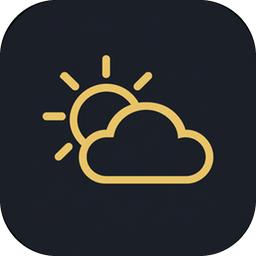<br><b>Weather</b><br><sub>The weather now and on the next days at a place named in the configuration, from Open-Meteo.</sub><br><code>weather</code></td>
<td width="25%" valign="top">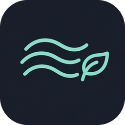<br><b>Air quality</b><br><sub>The European Air Quality Index, particles and ozone at a place named in the configuration, from Open-Meteo.</sub><br><code>air-quality</code></td>
<td width="25%" valign="top">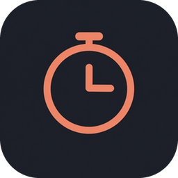<br><b>Pomodoro</b><br><sub>A focus timer of work and breaks for the bar, counting the rounds done today; it keeps time across restarts.</sub><br><code>pomodoro</code></td>
<td width="25%" valign="top">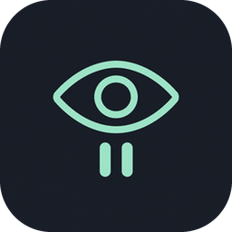<br><b>Eye breaks</b><br><sub>Reminders to look away from the screen for a moment, every twenty minutes unless set otherwise.</sub><br><code>breaks</code></td>
</tr>
<tr>
<td width="25%" valign="top">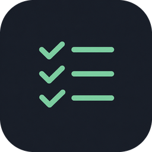<br><b>Habits</b><br><sub>Daily habits to check off in a popup, with streaks kept across restarts.</sub><br><code>habits</code></td>
<td width="25%" valign="top">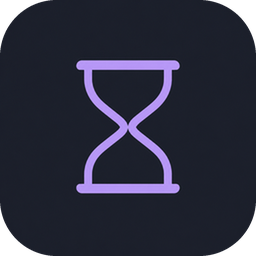<br><b>Countdown</b><br><sub>The time left until named dates of the configuration, the nearest one in the bar.</sub><br><code>countdown</code></td>
<td width="25%" valign="top">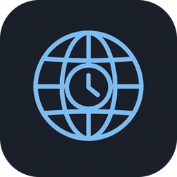<br><b>World clock</b><br><sub>The time in other places, at fixed offsets from UTC named in the configuration.</sub><br><code>world-clock</code></td>
<td width="25%" valign="top">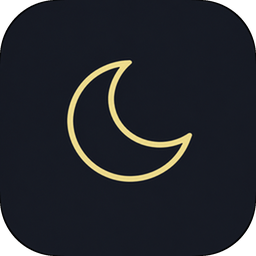<br><b>Moon</b><br><sub>The phase of the moon, how much of it is lit and when it is next full or new, worked out offline.</sub><br><code>moon</code></td>
</tr>
<tr>
<td width="25%" valign="top">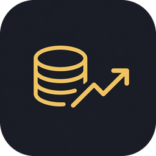<br><b>Crypto prices</b><br><sub>Prices of coins and their change over a day, from CoinGecko.</sub><br><code>crypto</code></td>
<td width="25%" valign="top">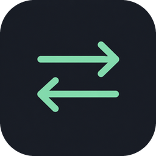<br><b>Exchange rates</b><br><sub>Currency exchange rates against a base currency, from ExchangeRate-API, updated daily.</sub><br><code>exchange</code></td>
<td width="25%" valign="top">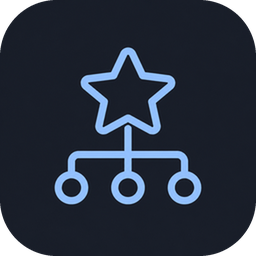<br><b>GitHub stats</b><br><sub>Stars, forks and open issues of GitHub repositories named in the configuration.</sub><br><code>github-stats</code></td>
<td width="25%" valign="top">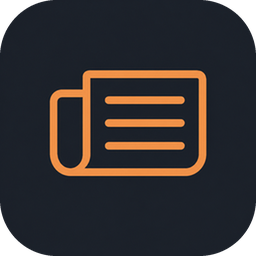<br><b>Hacker News</b><br><sub>The top stories of Hacker News with their points and comments.</sub><br><code>hacker-news</code></td>
</tr>
<tr>
<td width="25%" valign="top">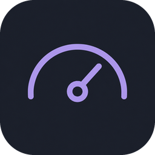<br><b>AI limits</b><br><sub>What is left of the usage limits of Claude, Codex, OpenRouter and DeepSeek, and when they reset.</sub><br><code>ai-limits</code></td>
<td width="25%" valign="top">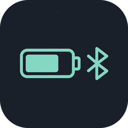<br><b>Device battery</b><br><sub>An example: the charge of a Bluetooth device in the bar, and every paired device in a popup.</sub><br><code>device-battery</code></td>
<td width="25%" valign="top">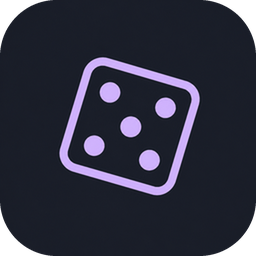<br><b>Dice</b><br><sub>Dice, a coin and answers to questions asked in silence, offline.</sub><br><code>dice</code></td>
<td width="25%" valign="top">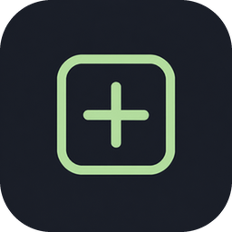<br><b>Counter</b><br><sub>An example: counts presses of its buttons, in a bar and in a popup of its own.</sub><br><code>counter</code></td>
</tr>
</table>

Write your own in any language that compiles to a WebAssembly component; [`extensions/kit`](extensions/kit) gives Rust plugins the bindings and a small UI builder. See [docs/EXTENSIONS.md](docs/EXTENSIONS.md).

## Install

1. Download `tessera-win64.zip` from the [latest release](https://github.com/redstone-md/tessera/releases) and unpack it anywhere.
2. Run `tessera.exe`. The Windows taskbar hides while Tessera runs and comes back when it exits.
3. Open the gear in the bar for **Settings**: pick an arrangement (`macOS`, `Windows`, `Void`), a theme and a language.

To leave, use **Quit** at the bottom of the settings or run `tessera quit`. Requires Windows 11.

## Configure

Tessera reads `%APPDATA%\tessera\config.toml` and applies every change within about two seconds, without a restart.

```toml
theme = "aurora"
windows_key = "launcher"

[[surface]]
edge = "top"
thickness = 44
start  = ["workspaces", "focused"]
center = [{ widget = "clock", popup = "calendar" }]
end    = ["tray", "files", "network", { widget = "volume", popup = "sound" }, "disk", "battery"]

[[key]]
press = "win+e"
files = "~"

[tiling]
enabled = true
layout = "master"
```

The annotated [default configuration](crates/tessera/src/default_config.toml) lists every option; [docs/CONFIGURATION.md](docs/CONFIGURATION.md) explains layouts, popups, cards, themes and languages.

## Build from source

Requires stable Rust with the MSVC toolchain and the Windows SDK.

```sh
cargo run --release
```

Plugins build separately for WebAssembly:

```sh
rustup target add wasm32-unknown-unknown
sh registry/update.sh
```

Releases are built and published by CI only when a tag such as `v0.3.0` is pushed; the workflow checks formatting, lints, runs the tests and builds every plugin first.

## Documentation

| Document | Contents |
| --- | --- |
| [docs/FEATURES.md](docs/FEATURES.md) | Every surface and widget in detail, with what was tried and what was not |
| [docs/CONFIGURATION.md](docs/CONFIGURATION.md) | Layouts, popups, cards, themes, languages, the file manager |
| [docs/EXTENSIONS.md](docs/EXTENSIONS.md) | The plugin model, permissions, registries and the examples |
| [CONTEXT.md](CONTEXT.md) | The vocabulary of the project |

## Contributing

Issues and pull requests are welcome. English is the project language; please read the [contribution guide](CONTRIBUTING.md), the [Code of Conduct](CODE_OF_CONDUCT.md) and the [security policy](SECURITY.md).

The previous Slint-based implementation remains at the [`v0.1.0-alpha.22`](https://github.com/redstone-md/tessera/releases/tag/v0.1.0-alpha.22) tag; it is unmaintained.

## License

Copyright © 2026 Tessera contributors. Licensed under the **GNU General Public License, version 3 only** — see [LICENSE](LICENSE). Third-party components keep their own licenses.
